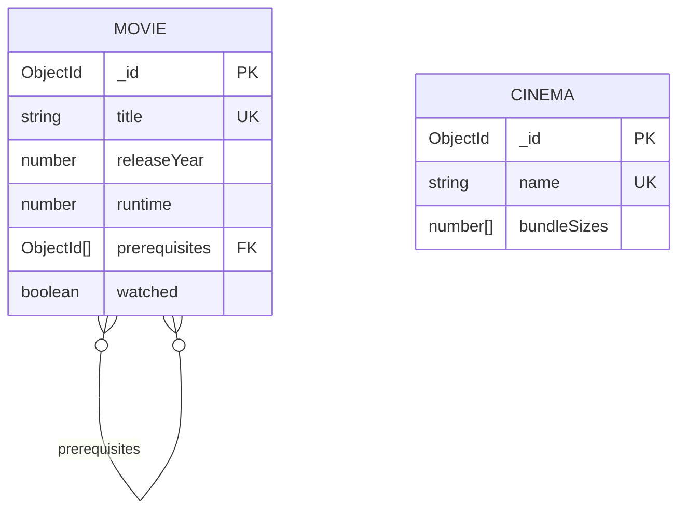

# Doomsday Ready

## 1. AI Usage Disclosure

AI assistance was used for UI design, project planning, development guidance, debugging and resolving errors, understanding problems and application logic, and code explanations.

## 2. Data Model Diagram

## 3. Technology Stack

## Backend

NestJS

TypeScript

MongoDB

Mongoose

Class Validator

## -Frontend

React

TypeScript

Vite

Tailwind CSS

React Router

Axios

## -DevOps

Docker

Docker Compose

## Getting Started

Run with Docker Compose

Clone the repository:

git clone https://github.com/mohammadamzad38/doomsday-ready.git
cd doomsday-ready

Application URLs:

Frontend: http://localhost:5173

Backend API: http://localhost:3000/api

MongoDB: localhost:27018

## Environment Variables

See backend/.env.example and frontend/.env.example for the required environment configuration.